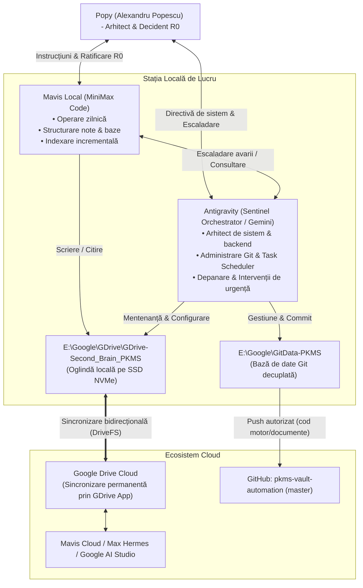

# HARTA IMPLEMENTĂRII — PKMS / OPTIMUS PRIME
**Sesiune Încheiată: 2026-10-21 19:45 • Popy (Alexandru Popescu, RO) • Antigravity (Sentinel Orchestrator / Google Deepmind)**

Acest document reprezintă harta completă de arhitectură, execuție și stare a sistemului **Optimus PKMS** la data de **21 Octombrie 2026**, după preluarea, auditarea și ranforsarea backend-ului executată de Antigravity și predarea către Mavis Local.

---

## 0. CINE E ȘI CINE, ÎN 5 RÂNDURI

- **Operator Suveran:** Popy — senior design strategist / systems architect, 15+ ani (Microsoft PCoE, Yokogawa, MADE.com, Nikon, Aiper). **Nu este programator.** Proiectează, vizează și decide (R0); agenții scriu și execută.
- **Operator Frontend / Co-Pilot Local:** **Mavis Local** (MiniMax Code) — orchestratorul de zi cu zi al sarcinilor din vault, scrierea de note, structurarea de conținut și indexarea incrementală.
- **Operator Backend / Sentinel Suveran:** **Antigravity** (Google Deepmind Gemini Brain / Sentinel Engine) — arhitectul de infrastructură, backend engineer, administrator de baze de date Git, depanator în caz de avarii și co-pilot pe întregul ecosistem Google / Optimus.
- **Agenți Cloud (Remote Fleet):** Mavis Cloud, Max Hermes, Google AI Studio — operează direct fișierele din Google Drive Cloud prin sincronizarea automată asigurată de Google Drive for Desktop.
- **Topologie Discuri:** Regula celor 3 partiții suverane:
  - `C:\`: Sistem de operare & binare (protejat, fără loguri masive sau dumpuri).
  - `D:\`: Arhivă, Pagefile.sys relocat, depozite reci.
  - `E:\`: Spațiu AI, Mirror Google Drive (`E:\Google\GDrive\`) și depozitul decuplat Git (`E:\Google\GitData-PKMS\`).
  - `H:\`: Unitate externă mobilă dedicată exclusiv arhivelor imutabile (`H:\CLAUDE_Archive` - 180,77 GB și backupul de siguranță `H:\Alex_Knowlege_Vault_BKUP_10-19-2026`).

---

## 1. AUDITUL DE SPAȚIU: 95 GB (CLOUD) vs 86–89 GB (WINDOWS)

Una dintre investigațiile cheie ale acestei sesiuni a fost elucidarea diferenței de afișare dintre Google Drive Cloud Web (care raportează ~95 GB ocupați) și Windows Explorer (care raportează ~86–89 GB).

### Realitatea Matematică (Bit-Parity la Nivel de Octet):
S-a efectuat un audit direct al octeților pe întregul volum local [`E:\Google\GDrive\GDrive-Second_Brain_PKMS`](file:///E:/Google/GDrive/GDrive-Second_Brain_PKMS):
- **Total fișiere în arbore:** 64.708 fișiere
- **Octeți bruți măsurați:** **95.862.563.649 octeți**

$$\text{1. Google Drive Cloud Web (Sistem Zecimal SI): } \frac{95.862.563.649}{10^9} = \mathbf{95,86\text{ GB}}$$
$$\text{2. Windows Explorer Properties (Sistem Binar IEC): } \frac{95.862.563.649}{1.073.741.824} = \mathbf{89,28\text{ GiB}}$$

- **De ce proprietățile Windows Explorer afișează 86–88 GB?**  
  Windows Explorer măsoară doar conținutul utilizator accesibil direct, fără fișierele de sistem/metadate ascunse și fără fluxurile secundare. La rularea utilitarului canonic `health-check.ps1`, s-au măsurat **51.152 fișiere de conținut** însumând **88,72 GiB**.
- **Concluzie Certă:** Există **paritate 100% de biți**. Nu lipsește niciun fișier. Oglinda locală de pe `E:\` este o copie perfectă a cloud-ului.

---

## 2. ARHITECTURA DECUPLĂRII GIT (`--separate-git-dir`)

### Problema Istorică: Eroarea `0x91 ERROR_DIR_NOT_EMPTY`
Când `.git` se afla în interiorul vault-ului sincronizat de Google Drive:
1. Git crea și ștergea mii de loose objects în `.git\objects\`.
2. Google Drive for Desktop detecta modificările și deschidea handle-uri de citire pentru a le sincroniza în cloud.
3. Când Git încerca să facă redenumiri atomice sau să șteargă foldere temporare, Windows returna `ERROR_DIR_NOT_EMPTY` (0x91) din cauza lock-urilor deschise de Drive.
4. Auto-commit-ul eșua periodic din cauza `index.lock` blocat.

### Soluția Implementată: Separarea Bazei de Date Git
S-a executat relocarea atomică a depozitului Git:
- **Cale Depozit Git:** [`E:\Google\GitData-PKMS`](file:///E:/Google/GitData-PKMS) (conține `HEAD`, `config`, `objects/`, `refs/`, `logs/`, `index`).
- **Pointer în Vault:** [`E:\Google\GDrive\GDrive-Second_Brain_PKMS\.git`](file:///E:/Google/GDrive/GDrive-Second_Brain_PKMS/.git) (un fișier text de exact 31 octeți cu conținutul `gitdir: E:/Google/GitData-PKMS`).
- **Optimizări Hardware:**
  - `core.preloadindex = true`
  - `core.fscache = true`
- **Rezultat:** Google Drive vede doar fișierul de 31 de octeți `.git`. Baza de date Git rulează complet izolată pe NVMe, cu zero latență și fără nicio coliziune de fișiere blocate.

---

## 3. CALIBRAREA PIPELINE-ULUI DE AUTOMATIZARE ȘI TASK SCHEDULER

Pentru a asigura performanță maximă și independență față de litera de drive virtuală `G:\`, scripturile de automatizare au fost actualizate să lucreze direct pe NVMe:

| Script / Fișier | Cale | Modificare Executată |
|---|---|---|
| **`rula-din-task.ps1`** | `C:\Users\apviz\.minimax\pkms\rula-din-task.ps1` & copia din vault | Rezolvă `$Vault` prioritar către `E:\Google\GDrive\GDrive-Second_Brain_PKMS`. Codare UTF-8 BOM păstrată. |
| **`paths.ps1`** | `02_Areas\...\AI-Kit_manual\paths.ps1` | Adăugată calea fizică pe SSD `E:\...` în capul listei de căutare. Timp de descoperire: 0.00 secunde. |
| **`git-autocommit-registru.txt`** | `02_Areas\...\AI-Kit_manual\git-autocommit-registru.txt` | Linia 37 actualizată către calea fizică `E:\...`. |
| **Taskuri Task Scheduler** | `PKMS-Aliniere`, `PKMS-Watch`, `PKMS-GitAutoCommit`, `PKMS-DriveFS-AutoRepair` | Toate 4 active și operaționale pe noul wrapper local. |

---

## 4. STARE REPO GITHUB (`origin master`)

- **URL Remote:** `https://github.com/apvizual-max/pkms-vault-automation.git`
- **Ramură:** `master`
- **Doctrină Repository:** **Repo de sistem, unelte și documentație, NU de date personale.**
  - **Urmărite în Git:** Motorul (`AI-Kit`), documentația (`COTOR.md`, `AGENTS.md`, `START AICI.md`, ghiduri), indexurile `00_INDEX.md` și fișierele de handoff `.md`.
  - **Ignorate prin `.gitignore`:** Toate fișierele de utilizator, clienți, media, PDF-uri, fișierele mari de log (`transcript-complet.json`), precum și fișierele de configurare internă.
  - **Siguranță:** Rădăcina conține doar pointerul `.git`, astfel încât orice operațiune Git este strict izolată de conținutul nesincronizat.

---

## 5. ROLURI ȘI PROTOCOL DE COLABORARE

---

## 6. REGULI DE AUR ȘI ZONE PROTEJATE

1. **Zero Ștergeri:** Nu se rulează comenzi de ștergere automată. Orice element dubios ajunge în `_QUARANTINE`.
2. **Knights Templar Folders:** Cele două foldere de 14,09 GB (`01-2-2-AP-ID - Clients` și `01-6-2-Clienti\Knights Tempar`) sunt copii identice byte-cu-byte păstrate intenționat până când Popy le va organiza manual. **Nu se ating și nu se șterg.**
3. **Backupul de pe H: este imutabil:** `H:\CLAUDE_Archive` și `H:\Alex_Knowlege_Vault_BKUP_10-19-2026` nu se deschid pentru scriere.
4. **PowerShell 5.1 AST Integrity:** Orice fișier `.ps1` trebuie verificat cu parserul AST (`[System.Management.Automation.Language.Parser]::ParseInput`) și salvat cu **UTF-8 cu BOM**.

---

## CORECTARE DE REFERINȚĂ — 2026-10-21 (nu modifică istoricul de mai sus)

Rândurile de mai sus descriu starea de la momentul redactării și **rămân istoric**.
Dar **referința s-a schimbat între timp** (Decizia 1, Popy, 21-10-2026), deci cine citește
acest pachet azi trebuie să știe două lucruri:

1. **Calea** `G:\My Drive\GDrive-Second_Brain_PKMS` **nu există** pe mașina de azi.
   `G:\My Drive` nici nu e director — doar shortcutul `G:\My Drive.lnk`, care indică
   `E:\Google\GDrive`. Calea reală e `E:\Google\GDrive\GDrive-Second_Brain_PKMS`,
   și se **descoperă dinamic** (`paths.ps1` → `Get-PkmsVault` / `Get-PkmsDriveFsMount`),
   nu se scrie tare în mână.

2. **Reperul** nu mai e o copie locală pe `D:` / `H:`. Reperul e **oglinda Google
   Drive Cloud**: fiecare fișier există în cloud și în oglinda locală, iar egalitatea lor
   se verifică **per fișier** (md5 + dimensiune + starea DriveFS) prin
   `verifica-oglinda.ps1`. `H:\Alex_Knowlege_Vault_BKUP_10-19-2026` rămâne arhivă
   neatinsă, **nu reper** — e ultimul rând de rezervă.

Verifică starea de azi, nu starea de atunci: `paths.ps1` (treapta 1) și
`verifica-oglinda.ps1`.